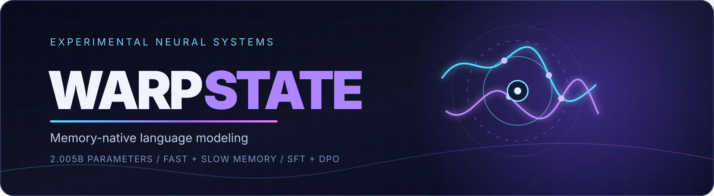
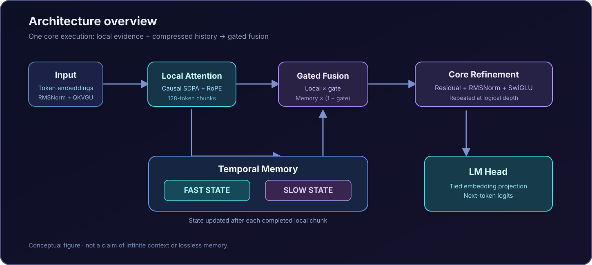

<div align="center">
  

  <h1>⚡ WarpState</h1>
  <p><strong>A memory-native language model built around local attention, fast/slow temporal states, and depth-wise computation.</strong></p>
  <p><em>Experimental architecture · Original 2.005B-parameter research run · Pretraining → SFT → DPO</em></p>

  <p>
    
    
    
    
  </p>
  <p><strong>Created by <a href="https://github.com/gtausa197-svg">Volodymyr Makarenko</a> · Co-authored &amp; sponsored by <a href="https://github.com/ykim078">@ykim078</a></strong></p>
  <p>
    <a href="#-what-is-warpstate">Overview</a> ·
    <a href="#-architecture">Architecture</a> ·
    <a href="#-training--evaluation">Results</a> ·
    <a href="#-getting-started">Quick start</a> ·
    <a href="#-project-leadership--sponsorship">Team &amp; sponsor</a>
  </p>
</div>

---

## 🧠 What is WarpState?

**WarpState** is an experimental autoregressive language model exploring a different way to balance *local precision* and *long-range continuity*. Instead of building a full sequence-wide attention matrix at every layer, it combines:

- **Causal local attention** within fixed **128-token chunks**.
- **Two decaying temporal memory states** (fast and slow) that carry compressed information from completed chunks.
- **Learned gating** that blends locally attended features with historical memory.
- **Depth-wise computation** through reusable model cores with depth-specific modulation.
- A full language-model training stack, including **BF16 computation / FP32 optimizer state**, checkpoint-resumable pretraining, supervised fine-tuning (SFT), and direct preference optimization (DPO).

The architecture is implemented in [`warpstate/model.py`](warpstate/model.py) and [`warpstate/config.py`](warpstate/config.py). **WarpState is not Project Nord's SNN architecture**: the supplied Project Nord README was used as a *presentation reference*, not as a source of WarpState features or benchmark claims.

> [!IMPORTANT]
> **Release contents:** The supplied source archives include Python code, the SentencePiece tokenizer, tests, and operational documentation, **but not pretrained weights, training data, or the `configs/` directory** referenced by several launchers. This README documents the historical research run described in the included records; the uploaded source package alone is **not** a one-command pretrained-model download. A complete runnable release must include the correct configuration files and access to trusted checkpoints.

## ✨ At a glance

| Research dimension | Documented state |
| :--- | :--- |
| **Model** | 2,005,111,424 parameters in the recorded full-size training run |
| **Tokenizer** | SentencePiece, 32,768-token vocabulary |
| **Training sequence** | 2,048 tokens; not equivalent to an exact 2,048-token persistent memory |
| **Local attention** | Causal SDPA, 128 tokens per chunk |
| **Persistent state** | Fast + slow fixed-size matrix state per attention head and core execution |
| **Training corpus prepared** | 40,000,000,000 train tokens + 1,048,576 validation tokens |
| **Pretraining completed** | 10,000,007,168 tokens, at step 76,294, per the September 2026 handoff |
| **Post-training** | 10,312 SFT updates; 2,334 DPO updates, reported complete |
| **Compute format** | BF16 forward/backward; FP32 parameters, gradients, and AdamW states |
| **Project stage** | Research implementation with historical training logs and tests; no independently verified general-purpose LLM benchmark in this package |

<sub>Numbers are sourced from the included source files and operational handoff documents, primarily `ops/RESTART_HANDOFF.md`, `ops/TRAINING.md`, `ops/DPO_HANDOFF.md`, and `ops/DPO_CHAT.md`. Training outcomes are historical records, not fresh measurements performed for this README.</sub>

---

## 🧬 Architecture

<div align="center">
  
</div>

### How one WarpState core works

1. **Normalize and project.** RMSNorm feeds one fused projection into queries, keys, values, a gate, and memory-write features.
2. **Attend locally.** Rotary position embeddings and causal scaled dot-product attention operate within each 128-token tile.
3. **Read compressed history.** Queries read from two memory matrices containing information written by *previously completed* tiles.
4. **Fuse the paths.** A learned sigmoid gate mixes local attention and fast/slow historical memory.
5. **Update memory.** Bounded, outer-product-like writes update the fast/slow states with separate learned decay coefficients.
6. **Refine the representation.** Residual projection, RMSNorm, and SwiGLU complete the block; the language model reuses cores across logical depth passes.

### Memory, not magic

The streaming path retains compact fast/slow state instead of an ever-growing full-attention key/value history. That does **not** imply infinite context, lossless recall, perfect retrieval, or constant runtime in every implementation mode. The optional parallel-memory path materializes tile-level interactions during training, and end-to-end cost depends on the kernel and execution configuration.

### Implementation highlights

| Module | What it does | Source |
| :--- | :--- | :--- |
| **WarpStateCore** | Local attention + two-timescale associative memory | [`warpstate/model.py`](warpstate/model.py) |
| **WarpStateLM** | Token embeddings, depth modulation, shared cores, tied output head | [`warpstate/model.py`](warpstate/model.py) |
| **Training runner** | Streaming data preparation, AdamW, validation, checkpoint/resume | [`run_40b.py`](run_40b.py) |
| **Distributed and kernel paths** | DDP, execution optimizations, matmul and backward experiments | [`ops/`](ops/) |
| **SFT** | Assistant-token-masked supervised fine-tuning | [`posttrain.py`](posttrain.py) |
| **DPO** | Preference optimization with a fixed reference model | [`dpo.py`](dpo.py) |
| **Inference probes** | CPU base-model chat and archived DPO inference tooling | [`chat.py`](chat.py), [`ops/DPO_CHAT.md`](ops/DPO_CHAT.md) |

---

## 📈 Training & evaluation

### Documented experimental milestones

| Phase | Recorded output | Interpretation |
| :--- | :--- | :--- |
| **Raw pretraining** | **10,000,007,168 tokens** · **76,294 updates** · validation loss **2.3497** | Pretraining token-level cross-entropy; **not** a claim that all 40B prepared tokens were trained |
| **SFT** | **10,312 updates** · **329,973 examples** · validation loss **1.1157** | Assistant-token-masked fine-tuning; its loss uses a **different objective** |
| **DPO** | **2,334 updates** · **74,661 preference pairs** · held-out DPO loss **0.5790** | Preference objective; **not** model perplexity or accuracy |

The included DPO record also reports positive relative reward margins for **245 / 339 held-out pairs (72.27%)**. This is a *margin statistic*, **not** an end-user generation win rate. Source: [`ops/DPO_CHAT.md`](ops/DPO_CHAT.md).

### Selected historical throughput observations

| Setup | Recorded observation | Scope / caveat |
| :--- | :--- | :--- |
| 2 × RTX PRO 6000 Blackwell Max-Q | **31,199 tokens/s** | September 13 analysis of a repeated 20-update, non-profiled configuration; excludes validation/checkpoint pauses |
| 1 × NVIDIA B200 | **20,752 sustained tokens/s**; **72,499 median tokens/s** | Specific 20-update autotuned benchmark with provider scheduling waits; excludes initialization, validation and saves |

These measurements describe **training throughput on the named server GPUs**, not inference speed, consumer GPU performance, or a reproducible speed promise. See [`ops/POINTWISE_HEADROOM_20260913.md`](ops/POINTWISE_HEADROOM_20260913.md) and [`ops/B200_PERFORMANCE.md`](ops/B200_PERFORMANCE.md) for test conditions and the discrepancy between median and sustained rates.

**What remains to be demonstrated publicly:** standardized language tasks, instruction following, multilingual quality, reasoning, independent reproducibility, and memory-retention tests. A low training loss alone cannot establish any of these capabilities.

---

## 🚀 Getting started

### 1. Assemble the source tree

The distributed archives contain complementary portions of the same project. Combine their contents under **one project root**, preserving `warpstate/`, `ops/`, root Python files, and `tokenizer.model`:

```text
WarpState/
├── README.md                    # This document
├── assets/                      # README visuals
├── warpstate/
│   ├── __init__.py
│   ├── config.py
│   └── model.py
├── ops/                         # Training, optimization, SFT/DPO tooling
├── configs/                     # REQUIRED for full training; not in supplied ZIPs
├── run_40b.py                   # Pretraining entry point
├── posttrain.py                 # SFT runner
├── dpo.py                       # DPO runner
├── chat.py                      # CPU base-model probe
├── tokenizer.model
├── README_UK.md                 # Existing Ukrainian server guide
└── test_*.py                    # Test suite
```

> [!WARNING]
> The 2.005B training configuration and the SFT/DPO plans under `configs/` were **not present** in the supplied archives. `WarpStateConfig()` has smaller development defaults and does **not** instantiate the documented 2.005B run. Restore the original configuration/plan files from your trusted project copy before attempting to reproduce the historical results.

### 2. Set up a Python environment

Use **Linux, Python 3.12, a supported NVIDIA GPU and a CUDA-compatible PyTorch build** for the documented full training workflow. The original server setup used high-memory RTX PRO 6000 or B200-class hardware; the 2B full-optimizer recipe is **not** an 8 GB VRAM training preset.

```bash
cd WarpState
python3.12 -m venv .venv
source .venv/bin/activate

# Select a PyTorch/CUDA build compatible with YOUR GPU and driver:
# https://pytorch.org/get-started/locally/
python -m pip install torch sentencepiece numpy
```

The historical automatic bootstrap is implemented in `run_40b.py`. Detailed, pinned deployment requirements are in `ops/training-requirements-resolved.txt`, `ops/B200_SETUP.md`, and `README_UK.md`; package resolution depends on your actual host.

### 3. Inspect the architecture without a checkpoint

```python
from warpstate import WarpStateConfig, WarpStateLM

config = WarpStateConfig()    # Development-sized defaults; NOT the historical 2.005B config
model = WarpStateLM(config)
print(f"Parameters: {model.num_parameters():,}")
```

This inspects randomly initialized code only. It does **not** provide a trained model.

### 4. Run a trusted base-model checkpoint

With the original compatible tokenizer and full `warpstate-server-v1` checkpoint available:

```bash
python3.12 chat.py \
  --checkpoint /path/to/trusted/latest.pt \
  --tokenizer ./tokenizer.model \
  --prompt "Explain how memory works." \
  --temperature 0
```

`chat.py` is a **CPU FP32 base-pretraining probe**. The DPO-tuned assistant uses a **different interface and archived snapshot format**; follow [`ops/DPO_CHAT.md`](ops/DPO_CHAT.md) and [`ops/RESTART_HANDOFF.md`](ops/RESTART_HANDOFF.md) on a host containing the original archives. Some operational scripts embed the historical `/workspace/WarpState/rtx6000_40b` layout and require path adaptation elsewhere.

### 5. Start or resume training (advanced)

Only after restoring the **matching** 2.005B config, tokenizer, trusted weights or explicit from-scratch initialization, GPU environment, disk space and dataset permissions:

```bash
# Example for a NEW run initialized from an existing trusted WarpState checkpoint
python3.12 run_40b.py \
  --weights /path/to/trusted/latest.pt \
  --config ./configs/warpstate_2b.json \
  --work-dir /path/to/warpstate-work
```

Alternatively, `--from-scratch` requests random initialization; it is **not** a way to load the trained 2B model. By default, the runner prepares **40B train tokens (~80 GB of `uint16` token data)** before full training. Even `--max-steps 10` does **not** skip full corpus preparation. Preserve checkpoint, tokenizer and data provenance when resuming. Never load untrusted `.pt`/pickle files.

Read [`README_UK.md`](README_UK.md), [`ops/TRAINING.md`](ops/TRAINING.md), and [`ops/LOCAL_RESUME.md`](ops/LOCAL_RESUME.md) before using production launchers.

---

## 🔍 Reproducibility & engineering

- **Deterministic corpus recipe:** FineWeb-Edu streaming, SentencePiece token counting, train/holdout split, provenance and SHA-256 manifests (see [`README_UK.md`](README_UK.md)).
- **Recoverable checkpoints:** complete FP32 model and AdamW state, RNG state, training cursor, run signature and guarded resume.
- **Precision discipline:** BF16 compute with FP32 master weights and optimizer; kernel changes require numerical comparisons.
- **Multiple execution modes:** compiled cores, gradient/communication overlap experiments, distributed training, asynchronous checkpoint writing and optional kernel tuning.
- **Testing:** unit and integration tests for training, checkpointing, transfer, post-training and distributed execution are included. Historical validation reports are not a substitute for rerunning them on a new host.

The repository also contains dated operational documents. **They describe specific machines and historical run states**, not universally safe commands to execute automatically on a new machine.

### Data and model safety

The original base data used [FineWeb-Edu](https://huggingface.co/datasets/HuggingFaceFW/fineweb-edu). Respect upstream dataset licenses and documentation, keep private checkpoints/logs out of Git, and treat PyTorch pickle checkpoints as trusted-code inputs. No datasets or trained weights are embedded in these README assets.

---

## 🗺️ Roadmap

- [x] Implement chunked causal attention with fast/slow temporal memory.
- [x] Implement depth-modulated reusable cores and tied language-model head.
- [x] Build resumable pretraining and GPU execution/optimization tooling.
- [x] Record a 10B-token pretraining milestone for the 2.005B experiment.
- [x] Record completed SFT and DPO stages in historical run documentation.
- [ ] Publish complete, reproducible configs and a verified release manifest.
- [ ] Publish licensed, integrity-checked downloadable checkpoints (if distribution is authorized).
- [ ] Add standardized benchmarks, memory-retention evaluations and representative generations.
- [ ] Consolidate deployment scripts and add CI for supported hardware paths.
- [ ] Document scaling, memory behavior and real inference performance across devices.

---

## 🤝 Project leadership & sponsorship

<table>
  <tr>
    <td align="center" width="50%">
      <strong>🧠 Project creator &amp; lead developer</strong><br/>
      <a href="https://github.com/gtausa197-svg"><strong>Volodymyr Makarenko</strong></a><br/>
      <sub>Core research direction, architecture and development</sub>
    </td>
    <td align="center" width="50%">
      <strong>💜 Project sponsor &amp; co-author</strong><br/>
      <a href="https://github.com/ykim078"><strong>@ykim078</strong></a><br/>
      <sub>Recognized as both sponsor and co-author of WarpState</sub>
    </td>
  </tr>
</table>

**Special thanks to [@ykim078](https://github.com/ykim078)** for supporting the project and participating as a **co-author**. Sponsorship and co-authorship are distinct roles; both are intentionally credited here at the project owner's request. Specific financial terms and individual code contributions are not claimed.

Contributions are welcome through issues and pull requests once the repository is published with a contribution policy and clear license.

## 📚 Documentation

| Guide | Purpose |
| :--- | :--- |
| [`README_UK.md`](README_UK.md) | Ukrainian source-package and GPU training guide |
| [`ops/RESTART_HANDOFF.md`](ops/RESTART_HANDOFF.md) | Recorded completed raw / SFT / DPO run and archive state |
| [`ops/B200_PERFORMANCE.md`](ops/B200_PERFORMANCE.md) | B200 benchmark conditions and results |
| [`ops/OPTIMIZED_TRAINING.md`](ops/OPTIMIZED_TRAINING.md) | Dual RTX PRO 6000 training measurements |
| [`ops/POSTTRAIN.md`](ops/POSTTRAIN.md) | SFT execution and data provenance |
| [`ops/DPO_HANDOFF.md`](ops/DPO_HANDOFF.md) | Preference optimization design |
| [`ops/DPO_CHAT.md`](ops/DPO_CHAT.md) | Post-DPO inference instructions and caveats |

## 📄 License & citation

**License:** No root `LICENSE` file was included in the supplied WarpState archives. **Do not assume an open-source license or reuse permission** until the repository owner publishes an explicit license. The Project Nord reference's Apache-2.0 label **does not automatically apply** to WarpState.

If citing the project, link to the **actual WarpState repository URL** once published; do not cite the unrelated Nord repository as its code source. Credit the creator and co-author as shown above.

---

<div align="center">
  <strong>⚡ WarpState</strong><br/>
  <em>Local attention for immediate detail. Temporal memory for continuity.</em><br/><br/>
  <sub>Built as an experimental research system. Documented results, explicit limitations, reproducible engineering.</sub>
</div>
